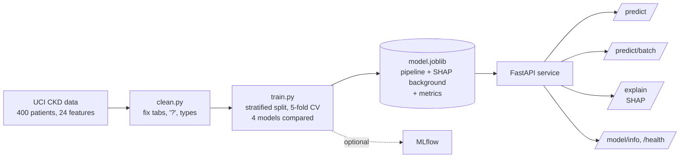

# Clinical Risk API: Chronic Kidney Disease

[](https://github.com/YOUR_USERNAME/clinical-risk-api/actions/workflows/ci.yml)


A REST API that predicts **chronic kidney disease (CKD) risk** from 24 routine clinical measurements and **explains every prediction with SHAP**, so a clinician can see *why* the model flagged a patient.

It turns the stacking ensemble from my AIAI 2025 paper ([Springer, DOI 10.1007/978-3-031-96235-6_15](https://doi.org/10.1007/978-3-031-96235-6_15)) into a tested, containerized service.

> Research and portfolio project. **Not a medical device. Not for clinical decisions.**

## Highlights

- **Stacking ensemble**: logistic regression + naive Bayes + gradient boosting, meta-learner logistic regression.
- **Leakage-free pipeline**: imputation, scaling and encoding live inside one scikit-learn `Pipeline`, fitted on training folds only.
- **Explainable**: `/explain` returns per-feature SHAP contributions that add up to the predicted probability, and flags which inputs were missing and imputed.
- **Handles missing labs**: every input is optional, as in real records.
- **Production basics**: FastAPI with input validation, Docker multi-stage build, health check, request timing, 17 pytest tests, GitHub Actions CI, optional MLflow tracking.

## Architecture



## Quickstart

```bash
git clone https://github.com/YOUR_USERNAME/clinical-risk-api.git
cd clinical-risk-api
docker compose up --build        # trains the model during the build, serves on :8000
```

Open http://localhost:8000/docs for interactive API docs.

Without Docker:

```bash
python -m venv .venv && source .venv/bin/activate
make install      # pip install -e ".[dev]"
make train        # trains on data/kidney_disease.csv, writes artifacts/model.joblib + metrics.json
make serve        # http://localhost:8000/docs
make test         # 17 tests, no real data needed
```

## Example

```bash
curl -X POST "http://localhost:8000/explain?top_k=3" \
  -H "Content-Type: application/json" \
  -d '{"age": 60, "serum_creatinine": 4.5, "haemoglobin": 9.0, "hypertension": "yes", "specific_gravity": 1.010}'
```

```json
{
  "ckd_probability": 0.9917,
  "prediction": "ckd",
  "risk_level": "high",
  "threshold": 0.5,
  "model_version": "0.1.0",
  "base_value": 0.4848,
  "contributions": [
    {"feature": "hypertension", "value": "yes", "imputed": false, "shap_value": 0.2452},
    {"feature": "haemoglobin", "value": 9.0, "imputed": false, "shap_value": 0.1038},
    {"feature": "red_blood_cell_count", "value": null, "imputed": true, "shap_value": 0.0902}
  ]
}
```
*(`missing_features` omitted for space.)* The third contribution comes from a value the user did **not** send: the API imputed it and says so. Hidden effects like this are what the `imputed` flag is for.

| Endpoint | Method | Purpose |
| --- | --- | --- |
| `/predict` | POST | CKD probability, label, risk level, list of imputed inputs |
| `/predict/batch` | POST | Up to 500 patients per request |
| `/explain?top_k=10` | POST | Prediction + top SHAP contributions |
| `/model/info` | GET | Model version, training date, CV and test metrics |
| `/health` | GET | Liveness check |

## Results

Stratified 80/20 split (random_state=42); 5-fold stratified CV on the training set; the test set is scored once.

| Model | CV ROC AUC | CV balanced acc. | CV recall | CV F1 |
| --- | --- | --- | --- | --- |
| Logistic regression | 1.000 ± 0.000 | 0.993 ± 0.010 | 0.985 ± 0.020 | 0.992 ± 0.010 |
| Naive Bayes | 1.000 ± 0.000 | 0.970 ± 0.015 | 0.940 ± 0.030 | 0.969 ± 0.016 |
| Gradient boosting | 0.998 ± 0.003 | 0.981 ± 0.029 | 0.995 ± 0.010 | 0.988 ± 0.019 |
| **Stacking** | 1.000 ± 0.000 | 0.992 ± 0.017 | 1.000 ± 0.000 | 0.995 ± 0.010 |

**Stacking, held-out test set (n = 80):** accuracy 1.000, balanced accuracy 1.000, recall 1.000, ROC AUC 1.000, Brier score 0.003.

Numbers come from `artifacts/metrics.json` (scikit-learn 1.9, `random_state=42`). The stacking model matches the paper's ~99% result even without the paper's preprocessing leakage. With only 400 patients from one hospital, though, this dataset is close to linearly separable (logistic regression alone reaches ROC AUC 1.000), so these scores do **not** show the model would generalize; external validation is needed.

## What changed from the paper notebook

| Notebook | This repo |
| --- | --- |
| Imputation and encoding on the full dataset before splitting | Inside the pipeline, fitted on training folds only (no leakage) |
| `LabelEncoder` per column | `OrdinalEncoder` with fixed categories, same at train and serve time |
| Random-sample imputation (not reproducible) | Median / mode imputation, seeded |
| Accuracy-focused | Balanced accuracy, recall, ROC AUC, Brier score, CV mean ± std |
| Notebook only | Package, API, tests, Docker, CI |

## Project structure

```
src/ckd_risk/
  features.py   feature schema, column mapping, units
  data.py       cleaning of the raw UCI / Kaggle files
  model.py      preprocessing + stacking pipeline
  train.py      CV comparison, test evaluation, saving, MLflow
  explain.py    SHAP permutation explainer
  schemas.py    Pydantic request/response models
  api.py        FastAPI app
scripts/        data download, synthetic data for tests
tests/          data, model and API tests
```

## Limitations

- 400 patients from a single hospital in India (2015); not representative of other populations.
- SHAP values describe the model, not causes of disease.
- Imputed values can drive a prediction; the `imputed` flag in `/explain` makes this visible.

## Data and citation

Rubini, L., Soundarapandian, P., & Eswaran, P. (2015). *Chronic Kidney Disease* [Dataset]. UCI Machine Learning Repository. https://doi.org/10.24432/C5G020 (CC BY 4.0)

```bibtex
@inproceedings{sharifuzzaman2025ckd,
  title     = {Optimized Machine Learning Models and Stacking Hybrid Approach for Chronic Kidney Disease Prediction},
  author    = {Sharifuzzaman, M. and Fahad, N. and Rabbi, R. I. and Jamal, S. R. and Tusher, E. H. and Hossen, M. J. and Ullah, M. S. and Islam, M. N.},
  booktitle = {Artificial Intelligence Applications and Innovations (AIAI 2025)},
  publisher = {Springer},
  year      = {2025},
  doi       = {10.1007/978-3-031-96235-6_15}
}
```

## Author

**Md Sharifuzzaman**: ML engineer and researcher in explainable AI for healthcare.
[LinkedIn](#) · [Google Scholar](#) · [Website](#)
